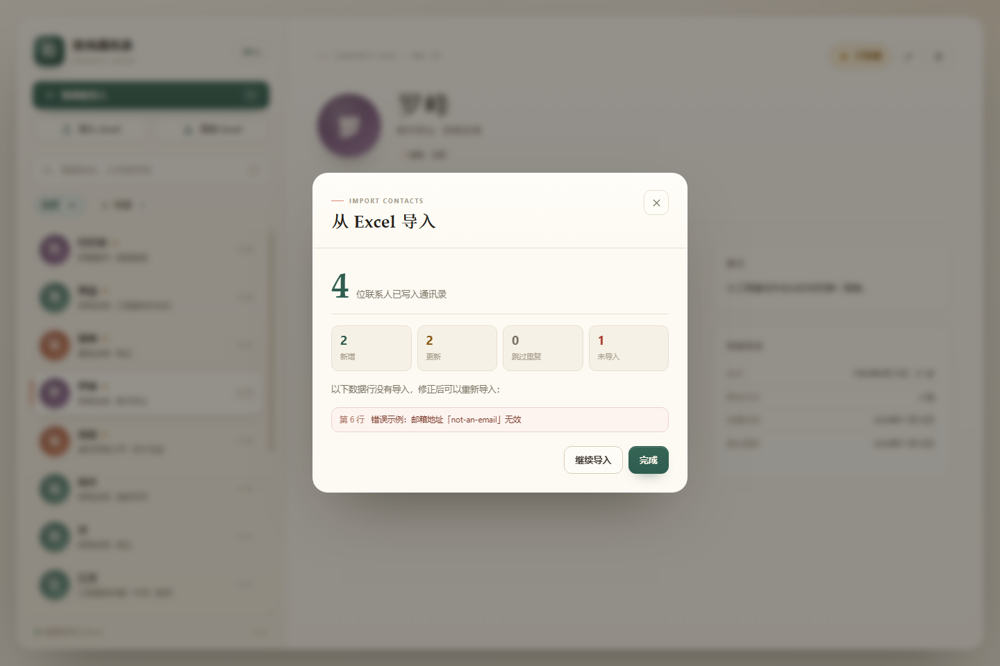

# 拾光通讯录 · Shiguang Address Book

A focused address book built for the Software Engineering (FZU–MU) Extreme
Programming assignment. It keeps frequently used people one click away, stores
as many contact methods as each person needs, and moves data in and out through
Excel. Accounts give every visitor a private address book, while anonymous
visitors can browse a read-only demo as a preview.


## Live demo

| Item | Value |
| --- | --- |
| URL | <http://47.118.56.190:8080/> |
| Preview | Anonymous visitors see 12 read-only demo contacts |
| Demo account | `demo2026` / `demo123456` |
| Own account | Register from the top bar; the new account starts empty |

The demo account contains the same Swallowed Star sample set. Import
`docs/samples/import-demo.xlsx` to reproduce the 2-created / 2-updated /
1-error import result shown in the screenshots.

## Features

| Requirement | Implementation |
| --- | --- |
| Bookmark contacts | A star button in each contact file, a pinned **收藏** filter in the sidebar, favorite-first sorting and an empty state for the favorite list. Toggling is optimistic and persisted immediately. |
| Multiple contact methods | Every contact owns an ordered list of methods: phone, email, WeChat, QQ, address and other. Each method has its own label (for example “公司” or “个人”), and the editor can add or remove rows freely. |
| Excel export | One row per contact, one column per information type (`手机1`, `手机2`, `邮箱1`, `微信`, `地址`, …). Styled header, frozen panes, filters and sensible row heights. |
| Excel import | Reads `.xlsx`/`.xlsm` files, maps the Chinese or English headers, validates every row, reports row-level errors, and can merge duplicates or skip them. |
| Accounts and preview | Salted `scrypt` password hashes, hashed session tokens in an HttpOnly/SameSite cookie, per-account contact scoping, and a read-only preview of legacy demo rows for signed-out visitors. |
| Page style | A soft-blue paper interface with responsive layouts, unified hover motion, visible keyboard focus rings, empty states and reduced-motion support. |
| Deployment | Node.js + Express + SQLite on an Alibaba Cloud ECS instance, served directly on port 8080 behind the cloud firewall. |

## Tech stack

- **Frontend** — semantic HTML, hand-written CSS (no framework), native ES
  modules. No build step: the server serves `public/` directly.
- **Backend** — Node.js 22.5+, Express 4, built-in `node:sqlite`, `exceljs` for
  workbook generation/parsing, `multer` for in-memory uploads.
- **Auth** — `node:crypto` `scrypt` password hashes, SHA-256 session token
  hashes, HttpOnly `SameSite=Lax` cookies.
- **Database** — SQLite in WAL mode: `users`, `sessions`, `contacts`,
  `contact_methods`. Contacts reference an owner through `contacts.user_id`;
  legacy rows keep `user_id = NULL` and become the read-only preview.
- **Tests** — `node:test` against an in-memory database: 13 contact/Excel
  scenarios plus 5 account, isolation and cookie scenarios.

## Quick start

Requirements: Node.js **22.5+** (the project uses the built-in `node:sqlite`
module). The reference environment is Node.js 24.

```bash
npm install
npm run seed     # optional: 12 Swallowed Star demo contacts as preview
npm start        # http://localhost:3000
```

Register an account to edit the address book. `npm run seed` only replaces the
`user_id IS NULL` preview rows; it does not delete accounts or their contacts.

Run the tests:

```bash
npm test
```

The database file is created at `data/addressbook.db`. Set `DB_PATH` to use a
different location and `PORT` to change the HTTP port. Set `COOKIE_SECURE=1`
when the app is served over HTTPS.

## Excel format

The import template is available in the running app from **导入 Excel → 下载导入模板**.

| 姓名 | 公司 | 职位 | 生日 | 标签 | 收藏 | 手机1 | 手机2 | 手机3 | 邮箱1 | 邮箱2 | 微信 | QQ | 地址 | 其他 | 备注 |
| --- | --- | --- | --- | --- | --- | --- | --- | --- | --- | --- | --- | --- | --- | --- | --- |
| 罗峰 | 极限武馆 | 银河领主 | 1995-08-15 | 战神、兄弟 | 是 | 13800001301 | | | luofeng@example.com | | luofeng_jx | | 江南基地市扬州城明月小区 8 栋 | | 示例行 |

- `姓名` is required; every other column is optional.
- `收藏` accepts `是/否`, `yes/no`, `true/false` or `1/0`.
- Multiple values inside one phone or email cell can be separated with `;`, `；`,
  a newline or ` / `.
- Extra phones beyond `手机3` and emails beyond `邮箱2` are folded into the last
  column of that type, separated by ` / `, so no data is lost on export.
- Supported files: `.xlsx` and `.xlsm`, up to 8 MB and 2,000 data rows. Legacy
  `.xls` files should be saved as `.xlsx` first.
- Import modes: **合并更新** updates a contact when both the name and a phone or
  email match; **跳过重复** leaves it untouched. Bad rows are reported with their
  row number and do not block the other rows.

## HTTP API

| Method | Path | Auth | Purpose |
| --- | --- | --- | --- |
| `GET` | `/api/health` | — | Health check |
| `POST` | `/api/auth/register` | — | Create an account and session |
| `POST` | `/api/auth/login` | — | Sign in |
| `POST` | `/api/auth/logout` | cookie | Destroy the session |
| `GET` | `/api/auth/me` | — | Current user or `null` |
| `GET` | `/api/contacts?q=&favorite=1` | optional | List/search own contacts, or the preview when signed out |
| `GET` | `/api/contacts/:id` | optional | Read one contact from the current scope |
| `POST` | `/api/contacts` | required | Create a contact with methods |
| `PUT` | `/api/contacts/:id` | required | Replace a contact and its methods |
| `PATCH` | `/api/contacts/:id/favorite` | required | Toggle the favorite flag |
| `DELETE` | `/api/contacts/:id` | required | Delete a contact |
| `GET` | `/api/export` | required | Download the account's contacts as `.xlsx` |
| `GET` | `/api/import/template` | — | Download the import template |
| `POST` | `/api/import` | required | Multipart upload (`file`, `mode=merge\|skip`) |

Errors use the shape `{ "error": { "code": "...", "message": "..." } }` with a
matching HTTP status. Every contact query is scoped by `contacts.user_id`, so
one account cannot read or mutate another account's rows.

## Project structure

```text
addressbook-assignment/
├── public/                 browser application (no build step)
│   ├── index.html
│   ├── css/style.css
│   └── js/{api,app,icons}.js
├── server/
│   ├── app.js              Express app factory
│   ├── index.js            HTTP entry point
│   ├── db.js               SQLite schema and legacy migration
│   ├── auth.js             scrypt, sessions, cookie middleware
│   ├── store.js            validation and per-user persistence
│   ├── excel.js            workbook build/parse and header mapping
│   ├── seed.js             demo data
│   └── routes/{auth,contacts,excel}.js
├── test/                   API, Excel and auth tests
├── deploy/                 Nginx, PM2 and systemd examples
├── docs/                   screenshots, demo video, test plan and samples
├── codestyle.md
└── package.json
```

## Screenshots

| Contact file (signed in) | Anonymous preview |
| --- | --- |
|  |  |

| Sign in | Import result |
| --- | --- |
|  |  |

| Excel export | Mobile layout |
| --- | --- |
|  |  |

A 48-second screen recording of the deployed app is available in the
[demo-v2 release](https://github.com/q1527700693-afk/832402115_addressbook/releases/download/demo-v2/addressbook-demo.mp4).
A shorter GIF preview is available at
[`docs/images/demo-preview.gif`](docs/images/demo-preview.gif).

## Deployment

The application is one Node.js process serving both the API and the static
frontend. The current demo runs on an Alibaba Cloud ECS instance without root:
Node 22 lives in `~/node22`, the app in `~/addressbook`, and the process listens
on `0.0.0.0:8080`. Port 8080 is opened in the security group and in `firewalld`;
no Nginx is required.

```bash
# inside the temporary deploy account
cd ~/addressbook
PATH=$HOME/node22/bin:$PATH PORT=8080 DB_PATH=$HOME/addressbook/data/addressbook.db \
  nohup node server/index.js > app.log 2>&1 &
```

For a persistent installation with a domain, put Nginx in front of port 3100
and use the examples in [`deploy/`](deploy/):

```bash
npm ci --omit=dev
DB_PATH=/var/lib/addressbook/addressbook.db PORT=3100 npm start
```

```nginx
location = /addressbook { return 301 /addressbook/; }
location /addressbook/ {
    proxy_pass http://127.0.0.1:3100/;
    proxy_set_header Host $host;
    proxy_set_header X-Real-IP $remote_addr;
    proxy_set_header X-Forwarded-For $proxy_add_x_forwarded_for;
    client_max_body_size 10m;
}
```

The frontend resolves API URLs relative to the page, so it works at the domain
root and under a sub-path without a rebuild.

## Security notes

- Passwords are salted `scrypt` hashes; plaintext passwords are never stored.
- Session tokens are 256-bit random values stored only as SHA-256 hashes, and
  the cookie is `HttpOnly`, `SameSite=Lax`, `Path=/`, with a 7-day lifetime.
- Contact reads and writes are scoped by owner; the anonymous preview can only
  see `user_id IS NULL` rows and cannot mutate anything.
- Uploads are limited to 8 MB, `.xlsx`/`.xlsm`, 2,000 rows, and are parsed in
  memory; formulas and macros are not executed.
- Known limits of this course deployment: HTTP only (so `Secure` cookies are
  off unless `COOKIE_SECURE=1` with HTTPS), no login rate limiting, no password
  reset, and the temporary account is removed after the assignment.

## License

MIT
